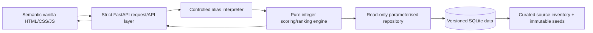

# Implemented architecture overview

Version: I-08 final artefact candidate, 2026-08-08.

The API layer performs composition, validation and evidence-safe event logging only. The interpreter uses NFKC/lowercase/punctuation/whitespace normalisation and exact predefined aliases. The engine applies stored relationships and rule rows, exclusions, integer weights and stable tie-breaking. The repository is opened in SQLite `mode=ro` for requests. The frontend uses `textContent` for all data and never scores or stores a request.

Runtime startup validates and rebuilds the generated local database from the curated seed. Synthetic fixtures remain independent. No LLM, embedding, external API, network lookup, random value, clock or mutable user state affects a decision.

Security/privacy boundaries: loopback only; same origin; no CORS middleware, authentication, cookie session, profile, history, telemetry, raw-input log or secret. Uvicorn is documented with access logging disabled.

Mapped evidence: `DATA_MODEL.md`, `UI_VERIFICATION.md`, `SOURCE_CURATION.md`, `SCORING_WORKED_EXAMPLE.md`, API snapshot and automated tests.
