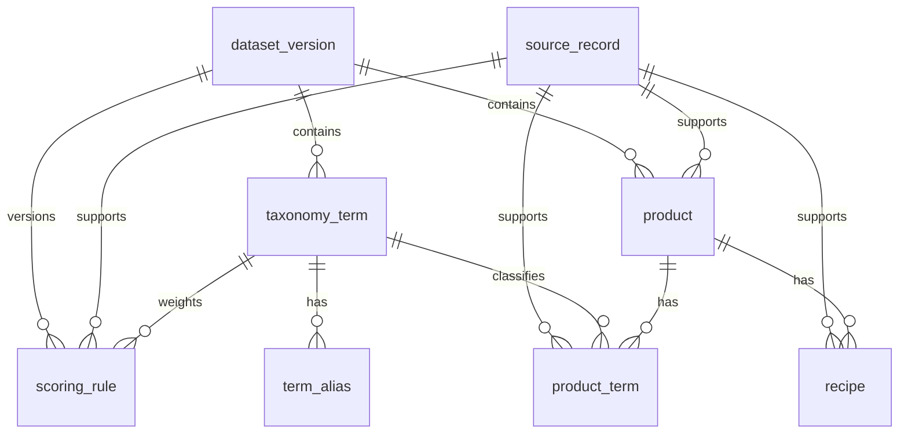

# Controlled data model (I-02)

`dataset_version` owns versioned taxonomy terms, products and scoring rules. `source_record` supplies explicit provenance; `term_alias` maps controlled phrases to taxonomy terms, with deliberate duplicate phrases for ambiguity tests. `product_term` records source-backed matches, exclusions or eligibility. Each active `scoring_rule` has a stable ID, taxonomy term, relationship, bounded integer weight, predefined reason, version and source. `recipe` preserves the authorised terminology using predefined text only. `boundary_pattern` contains predefined boundary codes and responses.

All content rows carry a source relationship, one partial unique index permits exactly one active dataset, foreign keys are enabled during construction and access is read-only at runtime. The committed seed is explicitly synthetic and neutral; generated SQLite files are excluded from Git.

